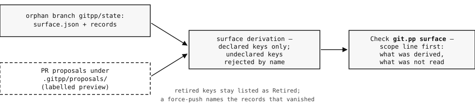

# ferryctl — ferry operations, with a declared coordination surface

**ferryctl is a small ferry-operations CLI: the day's sailings and
crew rota, plus the harbour's coordination board — who has claimed
which dock job, whether releases are frozen, whether deploys are
held, who holds the pager, which berth the fleet is assigned.**
Those coordination answers are not stored in this branch. They are
*derived* from git.pp records on an orphan branch (`gitpp/state`)
under a declared surface, and this repo is the working dogfood for
that mechanism (git.pp Mapping B): the CLI reads a derived snapshot
committed here, and the gitpp-app derives the same state live into
a Check on every push.

Plain Python, standard library only. There is nothing to install.

## Run it

```console
$ git clone https://github.com/patchwork-quilt/gitpp-dogfood-b1
$ cd gitpp-dogfood-b1

$ python3 ferryctl.py surface
ferry-ops surface — derived from gitpp/state @ c958ee9 (4 records · 3 keys · 1 conflict(s) · 0 orphan(s))
task.claim.dock-7 = agent-dockhand (winner claim-dock-7)
release.freeze = unset
deploy.hold = true (winner hold-storm; losers: genesis)
oncall.primary = rota-lead (winner oncall-rota)

$ python3 ferryctl.py claims
dock-7       agent-dockhand (record claim-dock-7)

$ python3 ferryctl.py hold
deploys HELD (winner hold-storm)

$ python3 ferryctl.py oncall
oncall.primary: rota-lead (record oncall-rota)

$ python3 ferryctl.py freeze
releases open — no freeze window on the surface

$ python3 ferryctl.py sailings --boat kestrel
06:10  kestrel  north -> south
07:25  kestrel  south -> north
09:00  kestrel  north -> south
# …the rest of the day's kestrel crossings follow
```

Every command above was executed against this tree; the outputs are
the program's own. `python3 ferryctl.py --help` lists the rest
(`crew`, `next <pier> <HH:MM>`, `berth`, and `--state <file>` to
read a different snapshot).

## The model

Two kinds of truth live in this repo, and the CLI keeps them apart:

- **The timetable and the rota are this repo's own data** —
  `ferryops/schedule.py` and `ferryops/crew.py`, edited like any
  code.
- **The coordination board is derived, never stored.** Several
  seats — humans and agents — work in this repo at once, and they
  collide over a handful of questions code review does not answer:
  who has claimed which dock job, whether releases are frozen,
  whether deploys are held and why, who holds the pager, which
  berth the fleet is assigned. Each seat lands its answer as a
  **record** — a small JSON file with an id, a kind, parents, and
  effects — on the orphan branch `gitpp/state`, by ordinary git
  push, under its own credentials. A **declaration**
  (`surface.json`, also on `gitpp/state`) names the keys that may
  be set and what each one means. The **fold** resolves the records
  into state: within a key, kind priority first (an override beats
  a task beats a witness), then ancestry, then a deterministic
  tie-break — arrival order is never an input, and losing records
  are preserved and named, not deleted.

`surface-state.json` on this branch is a **snapshot of that derived
state**, committed so the CLI (and any reader) can answer without
running the fold. It is generated, never hand-written:
`tools/derive-snapshot.mjs` folds the records through the same
derivation code the gitpp-app runs live, and the snapshot's
`derived_from` block names the branch tip and the fold source it
came from. When the surface moves, the snapshot is regenerated and
committed — the diff shows exactly which answers changed and which
record won them.

The gitpp-app is the other reader: installed on this repo, it
derives the surface on every push and posts it as an advisory
Check named `git.pp surface` — scope line first (what it derived,
what it did not read). The app writes nothing; records land by
ordinary git (Tier 1). [`RESULTS-B.md`](RESULTS-B.md) is the
acceptance record: the drills that proved the derivation, the
retirement semantics, and the force-push detection, Check by
Check.

## The declared surface



The declaration lives at
[`surface.json` on `gitpp/state`](https://github.com/patchwork-quilt/gitpp-dogfood-b1/blob/gitpp/state/surface.json),
with the records beside it in `records/`. The pointer file
[`.gitpp/surface.json`](.gitpp/surface.json) on this branch only
names the branch; the declaration itself lives there. The keys:

| Key | What it means |
|---|---|
| `task.claim.*` | Claim on one task: the key is `task.claim.<task-id>`, and the value is the seat (agent or human) working on it. |
| `release.freeze` | A freeze window while releases are frozen — an object `{"from": "YYYY-MM-DD", "to": "YYYY-MM-DD"}`; unset while releases are open. Set by override records. |
| `deploy.hold` | `true` while deploys are held; the reason rides in the record's reason field. |
| `oncall.primary` | The seat holding the pager right now, as a login or rota name. |

**Proposals** ride in pull requests as `.gitpp/proposals/*.json`:
a seat that wants to change the surface proposes the record in its
PR, where the preview Check derives the union and labels what is
landed and what is merely proposed. After merge, the record is
landed onto `gitpp/state` by the team's own push, exactly as it
was proposed.

**Retirement** is a declaration change, not a deletion: remove a
key from `surface.json` and its records stop deriving but stay on
the branch, still anchoring their descendants; re-declaring the
key revives its effects exactly as they were. And the branch's
history is part of the contract — a force-push or a deleted record
is detected and named by the next Check (drill 5B in RESULTS-B.md
is that firing, verbatim).

### Regenerating the snapshot

```console
$ git worktree add ../state-checkout gitpp/state   # or any checkout of the branch
$ node tools/derive-snapshot.mjs \
    --state-dir ../state-checkout \
    --worker <path to gitpp-app worker.js> \
    --tip "$(git rev-parse gitpp/state)" \
    --fold-source "<the fold's provenance label>" \
    --out surface-state.json
```

The tool refuses — loudly, writing nothing — on an invalid
declaration, a malformed record, or a duplicate record id.

## Layout

```
ferryctl.py              the CLI (argparse, stdlib only)
ferryops/schedule.py     sailings table + next-crossing logic
ferryops/crew.py         the rota
ferryops/surface.py      snapshot loading + board queries
surface-state.json       the derived surface snapshot (generated)
tools/derive-snapshot.mjs  the snapshot generator (node, no deps)
docs/mapping-b.svg       the surface flow diagram
tests/                   unittest, stdlib only (python3 -m unittest discover -s tests -t .)
RESULTS-B.md             the Mapping B acceptance record (append-only)
```

CI runs the full test suite plus CLI smoke commands on every push
and pull request.

## License

MIT — see [LICENSE](LICENSE).
